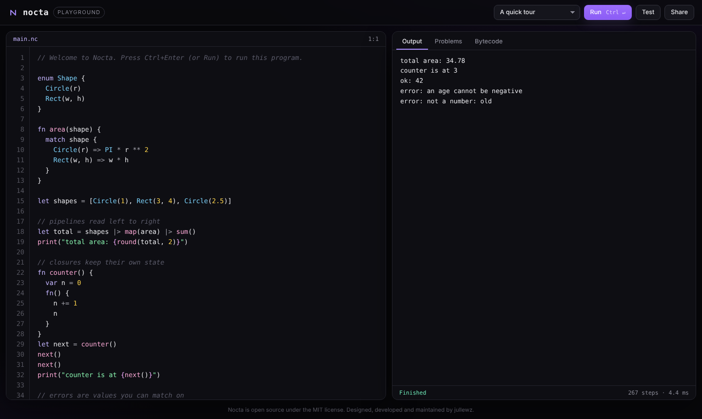
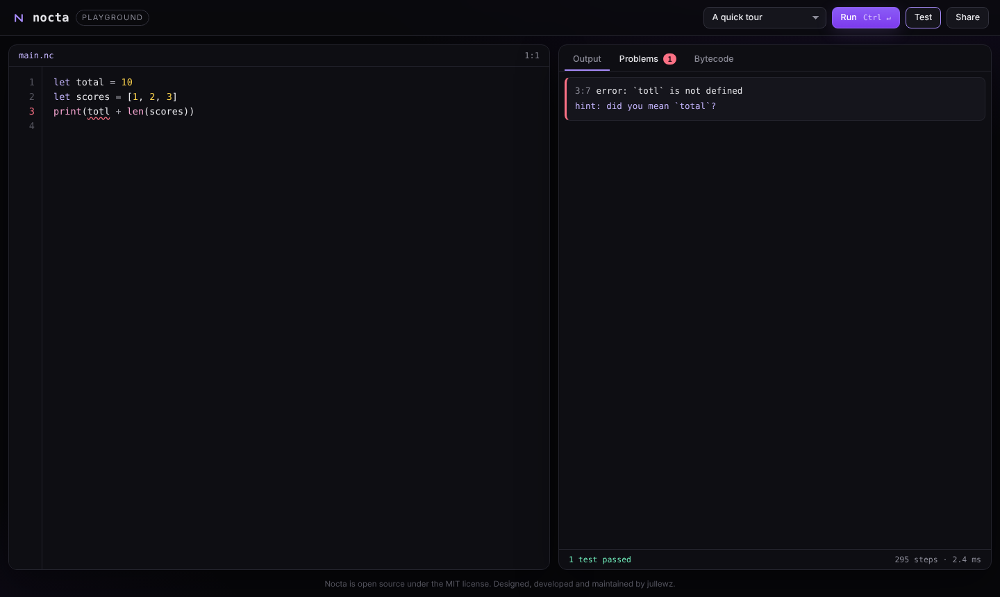
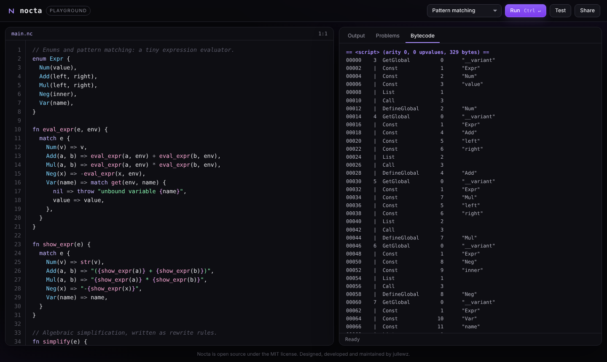

<div align="center">

# nocta

**A small, expressive programming language with a bytecode compiler, a virtual machine and a browser playground.**

Pattern matching · closures · enums · pipelines · string interpolation · test blocks · error messages that help

[Playground](#playground) · [Quick start](#quick-start) · [Language guide](docs/language.md) · [Standard library](docs/stdlib.md) · [Architecture](docs/architecture.md)

</div>



```nocta
enum Shape {
  Circle(r)
  Rect(w, h)
}

fn area(shape) {
  match shape {
    Circle(r) => PI * r ** 2
    Rect(w, h) => w * h
  }
}

let total = [Circle(1), Rect(3, 4)] |> map(area) |> sum()
print("total area: {round(total, 2)}")   // total area: 15.14
```

## Why Nocta

Nocta is a complete language implementation you can read in an afternoon and run anywhere Node.js or a browser
runs. It has no runtime dependencies.

- **A real compiler pipeline.** Source goes through a lexer, a Pratt parser with error recovery, a compiler that
  resolves every name at compile time, and a stack-based virtual machine with closures, upvalues and exceptions.
- **Errors that point at the problem.** Diagnostics show the line, a caret under the mistake and a hint, in the
  terminal and in the playground.
- **Patterns everywhere.** `match`, `let` and `for` destructure lists, maps, enum variants, ranges and literals,
  with guards and `|` alternatives.
- **Batteries included.** About 85 built-in functions for lists, strings, maps, math, JSON, `Option` and `Result`.
- **Testing built in.** Write `test "name" { ... }` next to your code and run `nocta test`.
- **Safe to embed.** A step limit stops infinite loops, deep recursion becomes a catchable error, and programs
  touch nothing outside the values you give them.

```text
error[undefined-name]: `totl` is not defined
  --> main.nc:3:7
  |
3 | print(totl + len(scores))
  |       ^^^^
  = hint: did you mean `total`?
```

## Quick start

You need [Node.js](https://nodejs.org/) 20 or newer. Nocta works on Windows 10 and 11, macOS and Linux.

```bash
git clone https://github.com/jullewz/nocta.git
cd nocta
npm install
npm run build
```

Run a program, its tests, or the interactive prompt:

```bash
node dist/src/cli/main.js run examples/patterns.nc
node dist/src/cli/main.js test examples/testing.nc
node dist/src/cli/main.js repl
```

To use the `nocta` command everywhere, run `npm link` once. Then:

```bash
nocta examples/fizzbuzz.nc
nocta eval "list(1..=5).map(fn(n) => n * n)"
```

On Windows, use the same commands in PowerShell or Command Prompt. Paths with backslashes work too:
`nocta run examples\life.nc`.

### Commands

| Command | What it does |
| --- | --- |
| `nocta FILE` or `nocta run FILE` | Run a program |
| `nocta test FILE...` | Run the `test` blocks in one or more files |
| `nocta check FILE...` | Report errors and warnings without running |
| `nocta disasm FILE` | Print the compiled bytecode |
| `nocta eval CODE` | Run code from the command line and print the last value |
| `nocta repl` | Interactive prompt with multi-line input and `:help`, `:globals`, `:builtins`, `:doc NAME` |

Options: `--steps N` stops after N instructions, `--seed N` makes `random()` reproducible, `--no-warnings` hides
warnings.

## Playground

The playground is a static page. Start it locally:

```bash
npm start              # builds, then serves http://127.0.0.1:5173
```

It has live diagnostics with squiggles as you type, syntax highlighting, a console, a test runner, a bytecode
view, ten examples and share links that carry the code in the URL. Programs run in your browser and nothing is
sent anywhere. A step limit of 50 million instructions keeps runaway loops from freezing the tab.

`npm run site` builds a deployable copy into `site/`. The included GitHub Pages workflow publishes it on every
push to `main` once Pages is enabled for the repository (Settings → Pages → Source: GitHub Actions).

| Diagnostics | Bytecode |
| --- | --- |
|  |  |

## A tour of the language

```nocta
// let is immutable, var is mutable
let name = "Nocta"
var count = 0
count += 1

// functions are values; the last expression is the result
fn greet(who) { "hello, {who}!" }
let double = fn(n) => n * 2

// lists, maps and ranges
let primes = [2, 3, 5, 7]
let user = {name: "Ada", langs: ["en", "fr"]}
for i in 0..3 { print(i) }

// method syntax works for every function: xs.f(a) is f(xs, a)
print(primes.map(double).join(", "))      // 4, 6, 10, 14

// if, match, try and blocks are expressions
let size = if len(primes) > 3 { "big" } else { "small" }

// destructuring
let [first, ..rest] = primes
let {langs} = user

// errors: throw any value, or return Ok / Err
let parsed = try { from_json("[1, 2") } catch e { "bad json: {e}" }

// modules
import "geometry" as geo

test "doubling" {
  assert_eq(double(21), 42)
}
```

The [language guide](docs/language.md) covers every feature with examples.

## Embedding

Nocta is a TypeScript library too. The compiler and VM use no Node.js APIs, so they run in browsers and workers.

```ts
import { Nocta, NoctaError, RuntimeError } from "./dist/src/lang/index.js";

const nocta = new Nocta({ print: (line) => console.log(line), maxSteps: 1_000_000 });
try {
  nocta.run("main.nc", 'print("hi from {upper("nocta")}")');
  console.log(nocta.eval("[1, 2, 3].sum()")); // "6"
} catch (error) {
  if (error instanceof NoctaError) console.error(error.diagnostics);
  else if (error instanceof RuntimeError) console.error(error.message, error.trace);
}
```

See [docs/architecture.md](docs/architecture.md) for the API, the compiler and the instruction set.

## Project layout

```text
src/lang/      lexer, parser, AST, compiler, diagnostics, public API
src/runtime/   values, bytecode, virtual machine, standard library
src/cli/       the nocta command and REPL
src/web/       the browser playground
examples/      runnable programs (their output is checked by the tests)
tests/         node:test suites and expected outputs
docs/          language guide, standard library, architecture
```

## Development

```bash
npm test               # build and run every test
npm run typecheck      # strict TypeScript, no output
npm run format:check   # Prettier
npm run docs           # regenerate docs/stdlib.md from the doc strings
```

The test suite covers the lexer, parser recovery, diagnostics, every language feature, the standard library, the
examples' exact output and the playground's tour program. CI runs it on Linux, macOS and Windows with Node 20 and
22. See [CONTRIBUTING.md](CONTRIBUTING.md) for how to add syntax, instructions or built-in functions.

## Status

Nocta 0.1.0 is a first release. The language is small on purpose and will change before 1.0. Known limits:
numbers are 64-bit floats, there is no static type checker yet, and `record` is a reserved word for a future
feature. See [CHANGELOG.md](CHANGELOG.md).

## Creator

Nocta was created by [jullewz](https://github.com/jullewz).

Designed, developed and maintained by jullewz.

## License

[MIT](LICENSE) © 2026 jullewz
